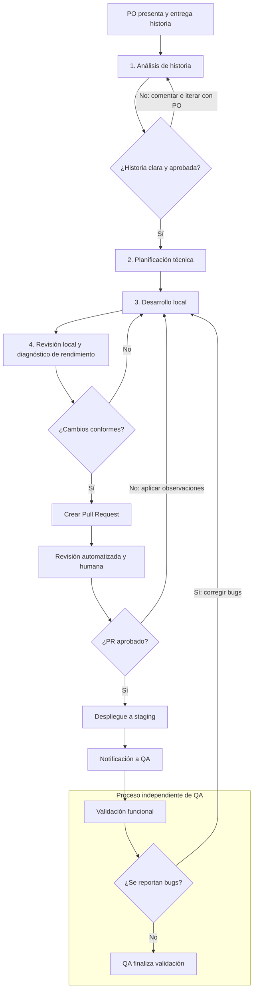

# Flujo de desarrollo asistido por IA

Este documento define un flujo de trabajo para el desarrollo de software asistido por IA mediante Codex, skills y MCP.

El objetivo es incorporar estas herramientas al proceso de ingeniería manteniendo la responsabilidad técnica y las decisiones funcionales en las personas. Greptile, GitHub Actions, Laravel Boost y Playwright son opcionales y solo deben utilizarse cuando estén instalados, configurados y aprobados para el proyecto.

La IA participa como herramienta de apoyo para el análisis, planificación, implementación, optimización y revisión de código.

El recorrido local puede coordinarse con `story-workflow` a partir de una historia
de Azure DevOps, una URL, un documento local/adjunto o requisitos escritos en el
mensaje. No exige crear una historia para trabajar desde otra fuente. El flujo
normaliza los requisitos y continúa por planificación, implementación,
verificación, revisión y correcciones cuando se solicita desarrollo completo.
Las decisiones funcionales bloqueantes siguen requiriendo aclaración; la entrega
a staging y el proceso independiente de QA conservan sus responsabilidades.

## 1. Flujo general

El proceso comienza cuando el Product Owner (PO) presenta y entrega una historia de usuario.

La historia es analizada, planificada e implementada por el desarrollador. Posteriormente se revisa el código, se crea el Pull Request y se realiza la revisión correspondiente antes del despliegue a staging.

Una vez disponible en staging, se notifica al equipo QA para iniciar su proceso independiente de validación.



> **Importante:** QA es un proceso independiente del desarrollo. Su ejecución comienza después de que la funcionalidad está disponible en staging y se notifica su entrega.
>
> Si QA reporta defectos, estos vuelven al flujo de desarrollo para su corrección, revisión y nuevo despliegue a staging. Los cambios de alcance deben revisarse con el PO.

---

## 2. Análisis de historia de usuario

**Responsables:** Product Owner y desarrollador.

**Herramientas:**
- Azure DevOps
- Codex
- Azure DevOps MCP
- Skill `review-user-story`

### Objetivo

Comprender completamente la historia de usuario antes de comenzar su implementación.

El PO presenta la historia, sus requisitos y criterios de aceptación. El desarrollador revisa su contenido y plantea dudas, observaciones o ajustes.

La IA puede apoyar en:

- Identificar requisitos ambiguos.
- Detectar criterios de aceptación incompletos.
- Proponer escenarios funcionales no contemplados.
- Identificar casos límite.
- Detectar posibles dependencias.
- Preparar preguntas para el PO.

### Ejemplo de uso

Desde Codex Desktop:

```text
$review-user-story

Analiza la historia #4521 de Azure DevOps.

Identifica:
- Ambigüedades.
- Requisitos faltantes.
- Criterios de aceptación incompletos.
- Casos límite.
- Preguntas para el Product Owner.

No modifiques código ni la historia.
```

### Iteración

Si existen dudas, el desarrollador las comenta con el PO.

La historia puede pasar por varias iteraciones hasta que su alcance y criterios de aceptación sean suficientemente claros.

La IA no debe asumir ni inventar reglas de negocio.

### Criterio de salida

- Historia comprendida.
- Ambigüedades relevantes resueltas.
- Criterios de aceptación definidos.
- Alcance aprobado para comenzar la planificación.

---

## 3. Planificación técnica

**Responsables:** Desarrollador y Tech Lead cuando corresponda.

**Herramientas:**
- Codex Desktop
- Skill `technical-planner`
- `AGENTS.md`
- Documentación de arquitectura
- Laravel Boost, cuando esté instalado

### Objetivo

Definir cómo implementar la historia considerando la arquitectura, dependencias y reglas existentes del proyecto.

Antes de proponer una solución, el agente debe investigar la implementación actual.

### Análisis esperado

**Backend**
- Controladores y servicios existentes.
- Modelos y relaciones.
- Validaciones y autorización.
- Jobs, eventos y listeners.
- Contratos de API.

**Base de datos**
- Tablas relacionadas.
- Migraciones necesarias.
- Índices y restricciones.
- Transacciones y concurrencia.
- Impacto en consultas existentes.

**Frontend**
- Componentes Vue involucrados.
- Estado y manejo de eventos.
- Comunicación con API o Inertia.
- Componentes reutilizables.
- Validaciones y estados de interfaz.

**Operación**
- Riesgos de rendimiento.
- Compatibilidad con la infraestructura.
- Procesamiento asíncrono.
- Posibles regresiones.

### Ejemplo de uso

```text
$technical-planner

Planifica la implementación de la historia #4521.

Investiga el código existente y entrega:

1. Análisis técnico.
2. Componentes afectados.
3. Solución propuesta.
4. Alternativas relevantes.
5. Tareas de implementación.
6. Riesgos y dependencias.
7. Estrategia de pruebas.

Respeta AGENTS.md.

No modifiques código todavía.
```

### Resultado esperado

Un plan técnico que identifique:

- Qué se modificará.
- Por qué se propone esa solución.
- Qué componentes podrían verse afectados.
- Qué tareas deben realizarse.
- Cómo se verificará la implementación.

### Criterio de salida

El desarrollador revisa y aprueba el plan.

En cambios de mayor complejidad o riesgo técnico, participa el Tech Lead.

### Aclaraciones durante la planificación

Después de investigar el código, la skill plantea las preguntas
necesarias para resolver decisiones que afecten la solución.

El desarrollador responde las decisiones técnicas y consulta al
PO cuando corresponde aclarar reglas de negocio o alcance.

La skill incorpora las respuestas al plan y distingue las
decisiones confirmadas de las recomendaciones y supuestos.
Puede continuar investigando aspectos independientes mientras
espera respuestas.

Si quedan decisiones bloqueantes, el plan se presenta como
CONDITIONAL o BLOCKED.

---

## 4. Desarrollo local

**Responsable:** Desarrollador.

**Herramientas:**
- Codex Desktop
- Laravel Boost
- Skills del proyecto
- PHPStan / Larastan
- PHPUnit / Pest
- ESLint
- Playwright, cuando corresponda

### Objetivo

Implementar la historia siguiendo el plan técnico aprobado y las convenciones del proyecto.

La IA puede colaborar mediante:

- Implementación de clases y métodos.
- Creación o modificación de componentes Vue.
- Generación de pruebas.
- Refactorización acotada.
- Investigación de errores.
- Reutilización de código existente.
- Análisis de consultas y rendimiento.

### Ejemplo de uso

```text
Implementa el plan técnico aprobado
para la historia #4521.

Consideraciones:

- Respeta AGENTS.md.
- Reutiliza la arquitectura existente.
- Mantén el alcance acordado.
- Agrega las pruebas correspondientes.
- Ejecuta las validaciones disponibles.
- Informa cambios y riesgos.

No realices commits automáticamente.
```

### Validaciones locales

Según los cambios realizados:

```bash
# Pruebas Laravel
php artisan test

# Análisis estático
vendor/bin/phpstan analyse

# Frontend
npm run lint
npm run build
```

Los comandos deben adaptarse a las herramientas realmente configuradas en cada repositorio.

Las pruebas que necesitan base de datos deben ejecutarse en un entorno aislado.

### Criterio de salida

- Funcionalidad implementada.
- Plan técnico respetado o desviaciones justificadas.
- Pruebas relevantes ejecutadas.
- Sin errores conocidos que bloqueen la entrega.
- Cambios listos para revisión local.

---

## 5. Revisión local y optimización

**Responsable:** Desarrollador.

**Herramientas:**
- Codex Review
- Skill `code-review`
- Skill `performance-optimizer`
- PHPStan / Larastan
- ESLint
- Playwright MCP, cuando corresponda

### Objetivo

Revisar los cambios antes de crear el Pull Request para reducir errores, regresiones y problemas de rendimiento.

Esta revisión es responsabilidad del desarrollador, aunque utilice IA para apoyarse.

### Revisión de código

La skill `code-review` debe evaluar:

La revisión respeta el alcance solicitado y carga únicamente las referencias relevantes de la skill. Si un cambio cruza varias capas, se cargan las referencias adicionales necesarias para seguir el flujo completo.

**Laravel / PHP**
- Errores de lógica.
- Autorización y validaciones.
- Regresiones funcionales.
- Excepciones y errores.
- Concurrencia y transacciones.
- Seguridad.

**Vue / JavaScript**
- Reactividad y manejo de estado.
- Props y eventos.
- Errores en solicitudes asíncronas.
- Limpieza de listeners y recursos.
- Accesibilidad.
- Comportamiento responsive verificable.

**Arquitectura**
- Consistencia con patrones existentes.
- Reutilización.
- Acoplamiento innecesario.
- Cambios fuera del alcance.
- Compatibilidad con otros módulos.

Por ejemplo, una revisión de un nuevo selector Vue no implica revisar PostgreSQL, Redis o Laravel salvo que el componente dependa directamente de esas capas.

### Ejemplo

```text
$code-review

Revisa los cambios de mi rama respecto de develop.

Identifica:
- Bugs.
- Problemas de seguridad.
- Regresiones.
- Problemas de concurrencia.
- Problemas en componentes Vue.
- Riesgos de producción.

Prioriza problemas verificables.

No modifiques código.
```

### Optimización

Cuando corresponde, utilizar `performance-optimizer`.

Esta skill puede investigar:

- Consultas Eloquent costosas.
- N+1.
- Índices PostgreSQL.
- Procesamiento de grandes volúmenes.
- Consumo excesivo de memoria.
- Jobs y colas Redis.
- Solicitudes HTTP redundantes.
- Operaciones costosas en Vue.

### Ejemplo

```text
$performance-optimizer

Analiza los cambios actuales.

Identifica oportunidades de optimización
en consultas PostgreSQL, Eloquent, PHP
y componentes Vue.

Prioriza mejoras con impacto demostrable.

No modifiques código.
```

Las optimizaciones deben preservar el comportamiento funcional.

`performance-optimizer` funciona en modo `DIAGNOSE` por defecto y no modifica código. La implementación de una optimización requiere aprobación explícita, una línea base, cambios acotados, pruebas y mediciones comparables antes y después. Nunca se deben inventar resultados de rendimiento.

### Criterio de salida

- Cambios revisados.
- Hallazgos relevantes corregidos.
- Propuestas de optimización justificadas.
- Optimizaciones implementadas y verificadas solo cuando fueron aprobadas.
- Validaciones ejecutadas nuevamente.
- Código listo para Pull Request.

---

## 6. Pull Request y revisión automatizada

**Responsables:** Desarrollador y reviewer.

**Herramientas:**
- GitHub
- GitHub Actions
- Greptile, cuando esté configurado
- Revisión humana

### Objetivo

Realizar una segunda revisión técnica del cambio antes de enviarlo a staging.

### Proceso

1. El desarrollador crea el Pull Request.
2. GitHub Actions ejecuta los controles configurados.
3. Las herramientas automatizadas configuradas analizan los cambios y reportan posibles problemas.
4. El desarrollador revisa las observaciones.
5. Se aplican las correcciones justificadas.
6. Se ejecutan nuevamente los checks necesarios.
7. El reviewer humano aprueba los cambios cuando corresponde.

### Herramientas automatizadas

Greptile u otra herramienta configurada puede revisar el PR considerando el contexto del repositorio.

Puede identificar:

- Posibles bugs.
- Regresiones.
- Problemas de lógica.
- Riesgos de seguridad.
- Problemas de mantenibilidad.

Las observaciones de Greptile deben ser evaluadas por el desarrollador. No todas requieren aplicar cambios automáticamente.

Si una herramienta reporta problemas relevantes, deben evaluarse y resolverse antes de continuar cuando corresponda.

### Criterio de salida

- PR aprobado.
- Observaciones relevantes atendidas.
- GitHub Actions aprobado.
- Cambios integrados según las políticas del repositorio.
- Funcionalidad lista para staging.

---

## 7. Despliegue a staging

**Responsable:** Desarrollo / proceso de despliegue.

### Objetivo

Publicar la funcionalidad revisada en el ambiente de staging.

### Proceso

1. Integrar los cambios aprobados.
2. Ejecutar el pipeline de despliegue.
3. Verificar que el despliegue finalizó correctamente.
4. Confirmar disponibilidad de la funcionalidad.
5. Notificar al equipo QA.

### Información recomendada para QA

La notificación debería incluir:

- Historia de Azure DevOps.
- Descripción breve de la funcionalidad.
- Criterios de aceptación.
- Ambiente disponible.
- PR asociado.
- Consideraciones relevantes para las pruebas.

### Criterio de salida de desarrollo

La funcionalidad está disponible en staging y QA ha sido notificado formalmente.

---

## 8. QA — Proceso independiente

**Responsable:** Equipo QA.

QA constituye un proceso independiente del desarrollo y comienza cuando la funcionalidad ha sido entregada correctamente en staging.

Su objetivo es validar el comportamiento funcional y comprobar que la implementación satisface los criterios de aceptación.

### Flujo

1. QA recibe la notificación de entrega.
2. Revisa la historia y los criterios de aceptación.
3. Ejecuta las pruebas correspondientes.
4. Registra los resultados.

### Si QA no encuentra defectos

La validación termina y la historia continúa según el proceso de entrega definido por la empresa.

### Si QA encuentra defectos

Los defectos se reportan al equipo de desarrollo.

El desarrollador debe:

1. Analizar el defecto.
2. Corregir el problema.
3. Ejecutar las pruebas correspondientes.
4. Revisar los cambios.
5. Crear o actualizar el PR según corresponda.
6. Pasar nuevamente por los controles de revisión.
7. Desplegar la corrección en staging.
8. Notificar a QA para su nueva validación.

Este ciclo se repite hasta resolver los defectos bloqueantes y obtener la aprobación de QA.

Si se detectan nuevos requisitos o modificaciones de alcance, deben revisarse con el PO antes de implementarse.

---

## 9. Integraciones

### Subagentes y automatización

Para historias que afectan varias capas, `story-analysis` coordina la
investigación independiente y reutiliza `technical-planner` para consolidar un
plan. La revisión de cambios puede delegarse mediante `parallel-review`, que
reutiliza `code-review` y devuelve un único informe. Los roles se sincronizan
desde `agents/` junto con las skills personales.

`story-workflow` agrega la coordinación de todo el desarrollo local y admite
fuentes distintas de Azure. Sus fases de análisis y revisión conservan el alcance
observacional; implementa el coordinador o workers de ejecución. Una solicitud
de desarrollo completo cubre esas etapas locales sin confirmaciones rutinarias.
Una solicitud de análisis no autoriza implementación.

Ambos flujos seleccionan las áreas pertinentes y trabajan sin modificar código.
La preparación técnica no sustituye la aprobación funcional ni autoriza la
implementación. Los cambios pequeños pueden resolverse en un solo hilo.

El comando `scripts/run-workflow.sh` permite ejecutar estos flujos en modo no
interactivo. La [guía de subagentes y automatización](subagents-and-automation.md)
describe los roles, la instalación, el uso manual y las alternativas para tareas
programadas y CI. `story-workflow --implement` habilita el desarrollo; los otros
flujos y el modo por defecto son de solo lectura. Los horarios y disparadores
se configuran por separado.

La configuración de Azure DevOps MCP está documentada por separado en [Azure DevOps MCP](integrations/azure-devops-mcp.md).

La configuración local, los paquetes, la autenticación y los permisos deben validarse en cada equipo. No se deben versionar tokens ni archivos de configuración privados.

---

## 10. Organización recomendada de skills

Las skills se mantienen en este repositorio central y pueden instalarse en cada equipo mediante [`scripts/install.sh`](../scripts/install.sh).

Ejemplo:

```text
codex-config/
└── .agents/
    └── skills/
    ├── review-user-story/
    │   └── SKILL.md
    ├── technical-planner/
    │   └── SKILL.md
    ├── code-review/
    │   └── SKILL.md
    └── performance-optimizer/
        └── SKILL.md
```

### Responsabilidades

| Skill | Propósito |
|---|---|
| `review-user-story` | Analizar requisitos y ambigüedades |
| `technical-planner` | Investigar el proyecto y definir un plan técnico |
| `code-review` | Auditar cambios, detectar bugs y regresiones |
| `performance-optimizer` | Analizar y optimizar consultas, recursos y rendimiento |

Las skills no sustituyen la revisión humana ni los controles automáticos.

### Instrucciones del proyecto

Cada repositorio debe mantener un `AGENTS.md` con información como:

- Arquitectura del proyecto.
- Stack tecnológico.
- Convenciones de desarrollo.
- Comandos de validación.
- Documentación de negocio.
- Contexto de Azure DevOps.
- Restricciones de operación.

Las instrucciones deben reflejar el estado real del proyecto.

El `AGENTS.md` de un repositorio de aplicación contiene contexto específico de ese proyecto. No debe reemplazarse por las instrucciones globales de este repositorio.

---

## 11. Principios generales

### Responsabilidad humana

El desarrollador es responsable del código que entrega, independientemente de cuánto haya participado la IA.

### Contexto antes de implementación

La IA debe investigar el sistema existente antes de proponer cambios importantes.

### Validación obligatoria

Todo cambio debe pasar por las pruebas y controles establecidos para el proyecto.

### Cambios acotados

No incorporar refactorizaciones o modificaciones ajenas al alcance sin justificación y aprobación.

### Evidencia sobre suposiciones

Los agentes deben distinguir entre hallazgos verificados, hipótesis y problemas pendientes de validación.

### QA independiente

La validación funcional corresponde al equipo QA. La IA puede apoyar, pero no reemplaza su proceso de aprobación.

---

## Referencias

- [OpenAI Codex](https://developers.openai.com/codex/)
- [Azure DevOps MCP](https://github.com/microsoft/azure-devops-mcp)
- [Laravel Boost](https://laravel.com/docs/boost)
- [Greptile](https://www.greptile.com/)
- [Playwright](https://playwright.dev/)
- [GitHub Actions](https://docs.github.com/en/actions)
